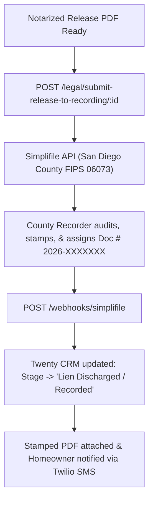
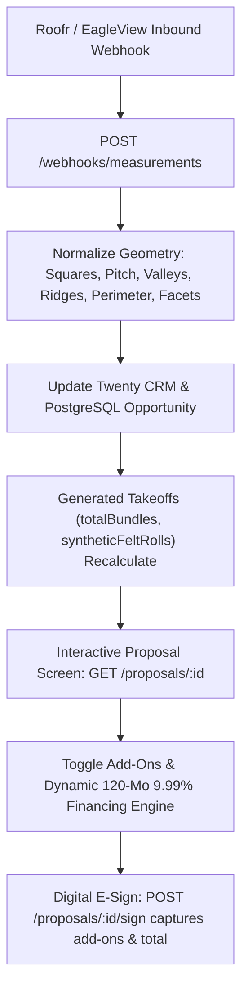
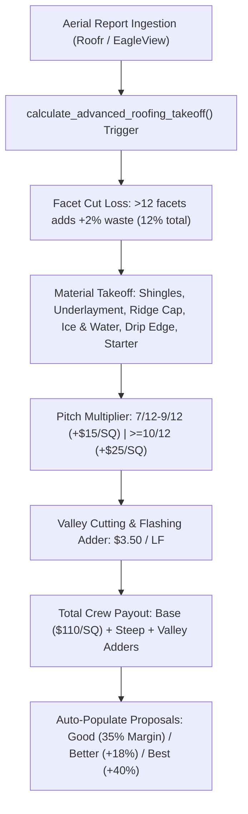

# Roofing CRM Architecture: Bridging Twenty CRM to JobNimbus

This directory contains the custom extensions, Postgres schemas, automated triggers, and React components to turn self-hosted **Twenty CRM** into a dedicated **Construction & Roofing CRM**, eliminating the $35–$85/user/month cost of JobNimbus while retaining contractor-first workflows.

---

## 1. Dual Pipeline Architecture (Sales vs. Production)

Standard B2B CRMs force closed deals into an archive or generic "Won" bucket. In roofing operations, winning the deal is just the halfway point: production (ordering materials, scheduling dumpsters, deploying crews) requires its own Kanban pipeline.

### A. Sales Pipeline (`opportunity`)
* **`NEW_LEAD`**: Inbound call, door knock, or web lead.
* **`INSPECTION_SCHEDULED`**: Ladder-assist or salesperson appointment set.
* **`INSPECTION_COMPLETE`**: Photos, pitch, and squares documented.
* **`ESTIMATE_SENT`**: Line-item takeoff presented to homeowner.
* **`INSURANCE_CLAIM_PENDING`**: Waiting for insurance adjuster meeting or scope approval.
* **`CONTRACT_SIGNED`**: Customer signed agreement and deposit collected.

### B. Production Pipeline (`job`)
When an opportunity transitions to `CONTRACT_SIGNED`, a native Postgres trigger (`fn_opportunity_contract_signed_create_job`) or backend subscriber immediately provisions a 1-to-1 production `job`:
* **`MATERIAL_ORDERED`**: Supplier PO submitted (ABC Supply, Beacon, SRS).
* **`CREW_SCHEDULED`**: Subcontractor assigned, delivery & dumpster drop confirmed.
* **`TEAR_OFF_IN_PROGRESS`**: Tear-off, sheathing repair, and installation active on site.
* **`FINAL_INSPECTION`**: Magnetic sweep, punch list, and municipal inspection passed.
* **`BILLED_PAID`**: Final invoice sent (depreciation/deductible/cash collected).

---

## 2. Roofing Data Model & Custom Objects

### A. `opportunity` (Roofing Scope & Takeoffs)
* `roofSquares` (`NUMERIC(8,2)`): Net surface area in squares (1 SQ = 100 sq ft).
* `pitch` (`VARCHAR`): Roof slope (e.g., 4/12, 6/12, 8/12, 12/12).
* `layers` (`INTEGER`): Tear-off thickness (1, 2, or 3 layers).
* `deckingType` (`VARCHAR`): OSB 7/16, Plywood 1/2", 1x Plank, Tongue & Groove.
* `materialType` (`VARCHAR`): Architectural Shingle, Metal Standing Seam, Tile, TPO/Flat.
* `wasteFactorPercent` (`NUMERIC`): Default 10% (simple gable) to 18% (complex hip/valleys).
* **Automated Stored Columns**:
  * `totalBundles`: `CEIL(roofSquares * 3.0 * (1 + waste/100))`
  * `syntheticFeltRolls`: `CEIL((roofSquares * (1 + waste/100)) / 10.0)`
  * `iceWaterShieldRolls`: `GREATEST(1, CEIL(roofSquares * 0.05))`
  * `ridgeCapBundles`: `GREATEST(1, CEIL(roofSquares / 7.0))`

### B. `claim_info` (Insurance Restoration Tracking)
* `insuranceCarrier`: State Farm, Allstate, Travelers, etc.
* `claimNumber`, `policyNumber`, `dateOfLoss`
* `adjusterName`, `adjusterPhone`, `adjusterEmail`, `adjusterMeetingDate`
* `deductibleAmount`: Homeowner out-of-pocket responsibility.
* `acvAmount`: Actual Cash Value (Initial check).
* `rcvAmount`: Replacement Cost Value (Full approved scope).
* `depreciationAmount` (Stored Generated): `rcvAmount - acvAmount` (Recoverable upon completion).
* `netClaimAmount` (Stored Generated): `rcvAmount - deductibleAmount`
* `supplementStatus` / `supplementAmount`: Xactimate supplement adjustments.

### C. `deal_line_item` (Material & Labor Estimating Rollup)
* `itemName`, `category` (MATERIAL, LABOR, EQUIPMENT, PERMIT, ACCESSORY)
* `unit` (SQ, LF, EA, ROLL, BUNDLE, BOX)
* `quantity`, `unitCost`, `unitPrice`
* `totalCost` (Generated): `quantity * unitCost`
* `totalPrice` (Generated): `quantity * unitPrice`
* `grossProfit` (Generated): `totalPrice - totalCost`
* `marginPercent` (Generated): `((totalPrice - totalCost) / totalPrice) * 100`

### D. `work_order` (Production Routing & Logistics)
* `jobId`: FK to `job`
* `subcontractorCrewLead`, `crewContactPhone`
* `permitNumber`, `permitIssuedDate`
* `dumpsterVendor`, `dumpsterSizeYards` (e.g. 20-yard), `dumpsterScheduledDate`
* `supplierName` (ABC Supply / Beacon), `deliveryDate`, `roofLoadType` (ROOFTOP_LOAD vs GROUND_DROP)
* `specialInstructions` (Plywood protection on driveway/AC, magnetic nail sweep).

---

## 3. Estimating & Material Calculations

### Quick Deployment via SQL:
Run the SQL scripts against your PostgreSQL database:
```bash
# 1. Apply schema alterations, custom tables, and automatic Job creation trigger
psql -d "twenty" -U "postgres" -f "custom-roofing-crm/01_roofing_schema_and_triggers.sql"

# 2. Seed material catalog, stored takeoff procedure, and rollup view
psql -d "twenty" -U "postgres" -f "custom-roofing-crm/02_seed_roofing_catalogs_and_views.sql"
```

### Auto-Generating Takeoffs:
To automatically generate a full JobNimbus-style line item estimate for any opportunity:
```sql
SELECT * FROM sp_generate_roofing_estimate_line_items('YOUR_OPPORTUNITY_UUID');
```

---

## 4. Field Photo Management & Work Order Routing

### A. Photo Categorization
In Twenty, photos attach via the `attachment` table. For roofing, tag attachments by milestone:
1. **Inspection / Pre-Existing Damage**: Hail impact marks, missing tabs, wind crease lines.
2. **Tear-Off / Decking**: Rotted plywood/decking verification before sheathing replacement.
3. **Dry-In**: Ice & Water shield in valleys/eaves and synthetic felt installed.
4. **Final / Completed**: Completed shingle lines, flashed pipe boots, chimney cricket, and cleaned grounds.

### B. Subcontractor Work Order Routing
The `work_order` object can be exported directly or rendered via Twenty's view engine to send crew leads a work packet containing:
* Rooftop delivery status and supplier ticket.
* Dumpster placement location.
* Number of layers and pitch hazard warnings.
* Labor payout contract amount.

---

## 5. CompanyCam Visual Asset Layer Integration

Instead of bloating your local PostgreSQL database with gigabytes of raw photos or paying high S3 egress fees, CompanyCam acts as the visual asset layer while Twenty acts as the single source of truth for CRM/Job status.

```
[Twenty CRM: Opportunity / Job Created]
                  │
                  ▼
         [TypeORM / Webhook Hook]
                  │
                  ▼
  [CompanyCam REST API: POST /v2/projects]
                  │
                  ▼
 [Store CompanyCam Project ID & URL on Twenty Record]
                  │
                  ▼
    [Display Embedded Gallery / Direct Launch]
```

### Files Added:
* **Schema & Triggers**: [`companycam/03_companycam_schema_and_triggers.sql`](file:///c:/Users/Meerkat/Desktop/roofcrmer/custom-roofing-crm/companycam/03_companycam_schema_and_triggers.sql)
  * Adds `companycamProjectId`, `companycamUrl`, `companycamShareLink`, `companycamPhotoCount`, `companycamCoverPhotoUrl` to both `opportunity` and `job`.
  * Creates `companycam_photo` table for zero-bloat metadata & CDN caching.
  * Adds trigger `trg_sync_companycam_to_production_job` so when an opportunity converts to a production job, CompanyCam project links transfer seamlessly.
* **REST API Service**: [`companycam/companycam.service.ts`](file:///c:/Users/Meerkat/Desktop/roofcrmer/custom-roofing-crm/companycam/companycam.service.ts)
  * Connects to `https://api.companycam.com/v2`.
  * `createProject`: Sends homeowner address, coordinates, and project name.
  * `listProjectPhotos`: Retrieves photos with annotations and GPS coordinates.
  * `createProjectShareLink`: Generates public gallery link for homeowners.
* **Automated Sync Subscriber**: [`companycam/companycam-sync.subscriber.ts`](file:///c:/Users/Meerkat/Desktop/roofcrmer/custom-roofing-crm/companycam/companycam-sync.subscriber.ts)
  * Listens to Opportunity creation and `INSPECTION_SCHEDULED`.
  * Spins up the project in CompanyCam and saves ID/URL back to Twenty.
* **Incoming Webhook Controller**: [`companycam/companycam-webhook.controller.ts`](file:///c:/Users/Meerkat/Desktop/roofcrmer/custom-roofing-crm/companycam/companycam-webhook.controller.ts)
  * Listens for `photo.created` and `photo.tagged`.
  * Instantly updates photo counts and live stream inside Twenty.
* **React Gallery & Quick Action Widget**: [`frontend/CompanyCamGalleryWidget.tsx`](file:///c:/Users/Meerkat/Desktop/roofcrmer/custom-roofing-crm/frontend/CompanyCamGalleryWidget.tsx)
  * **"Open in CompanyCam"** 1-click launch button.
  * **"Share Gallery"** link copy for homeowners and insurance adjusters.
  * Milestones filter chips: `Pre-Inspection`, `Tear-Off / Decking`, `Underlayment`, `Flashing`, `Final Roof`.
  * Fullscreen lightbox modal with GPS and annotation badges.
  * Embedded Iframe toggle option.

---

## 6. Crew Work Order PDF Generation (Puppeteer & Scannable QR)

To give field crews a stripped-down, margin-free dispatch slip without revealing pricing or gross profits, the `roofing-bridge` service exposes an automated PDF generation endpoint:

* **Endpoint**: `GET http://localhost:4000/work-orders/:id/pdf`
* **Features**:
  * Headless Chromium (Puppeteer) rendering print-optimized Letter PDF.
  * Embedded **CompanyCam QR Code** linking directly to the job's mobile photo album for mandatory pre-tear-off, decking inspection, and final cleanup documentation.
  * Technical checklist: Verified shingle bundle counts, synthetic rolls, layers, pitch, dumpster location, and safety directives.
  * Physical signature sign-off lines for Crew Lead and Project Manager.

### Embedding 1-Click Print Button in Twenty CRM:
1. In Twenty, navigate to **Settings $\rightarrow$ Objects $\rightarrow$ Opportunities** (or custom **Job** object).
2. Click **Add Field** $\rightarrow$ select type **Formula** (or **Links**).
3. Set label: `Print Work Order`.
4. Formula expression:
   ```
   CONCAT("http://localhost:4000/work-orders/", this.id, "/pdf")
   ```
5. When clicked on any record card, it immediately streams the crew PDF in a new tab ready to print or dispatch.

---

## 7. Automated Supplier Material PO Dispatch (Nodemailer / SMTP)

To dispatch itemized purchase orders directly to suppliers (ABC Supply, Beacon Building Products, SRS Distribution), the system provides an automated two-part pipeline:

### A. Microservice Backend Endpoint (`roofing-bridge` on `:4000`):
* **Endpoints**:
  * `POST /material-orders/:id/dispatch`: Generates high-res PO PDF and dispatches email with attachment.
  * `GET /material-orders/:id/pdf`: Direct browser preview & download of the generated PO PDF.
* **Payload**:
  ```json
  {
    "supplierName": "ABC Supply Co.",
    "supplierEmail": "orders.abcsupply@supplier.com",
    "deliveryDate": "2026-10-25",
    "deliveryMethod": "Rooftop Drop",
    "stagingNotes": "Driveway clear, watch overhead power lines."
  }
  ```
* **Operations**:
  1. Computes itemized roofing materials from `roofSquares`:
     * Architectural Shingles (`roofSquares * 3.3` bundles)
     * Synthetic Underlayment (`roofSquares / 10` rolls)
     * Starter Strip Course (`roofSquares * 0.4` bundles)
     * Hip & Ridge Cap (`roofSquares * 0.3` bundles)
     * Drip Edge Flashing (perimeter)
  2. Generates high-resolution printable HTML layout matching supplier PO specs.
  3. Uses **Puppeteer** to render an in-memory PDF buffer (`PO-XXXXXXXX-SupplierName.pdf`).
  4. Dispatches email via **Nodemailer** with the rendered PDF in the `attachments` array.
  5. Automatically transitions Opportunity / Job status in Twenty CRM:
     * `materialOrderStatus = 'Ordered'`
     * `purchaseOrderNumber = 'PO-XXXXXXXX'`

### B. Interactive Popover Modal (`MaterialOrderModal.tsx`):
* Replaces browser alerts with a popover modal dialog built with Twenty's theme tokens.
* **Controls**:
  * **Supplier Selector**: ABC Supply Co., Beacon Building Products, SRS Distribution (with automatic branch order-desk email routing).
  * **Requested Delivery Date**: Date picker (defaults to earliest available window).
  * **Drop Method**: Rooftop Drop (Boom Truck), Ground Drop (Driveway), Ground Drop (Backyard / Side).
  * **Staging & Access Notes**: Driveway clearance, paver protection, overhead utility lines, and 30-min call-ahead directives.

### C. Frontend Action Button (`GenerateMaterialOrderActionButton.tsx`):
* Mounted directly in Twenty CRM's record show header (`RecordShowHeader.tsx` & `RecordShowPageShell.tsx`) alongside `PrintWorkOrderActionButton`.
* **Restricted Target Objects**: Appears exclusively on `opportunity`, `job`, and `workorder` records.
* **UX States**:
  * Default: `<IconPackageExport /> Order Materials`
  * Active Modal: Launches interactive `<MaterialOrderModal />`
  * Submitting: `<IconLoader2 className="spin" /> Sending Order...`
  * Success: `<IconCheck /> PO Dispatched` (Persistent 5-second green banner)

---

## 8. "Text-to-Pay" via Stripe & Twilio

JobNimbus highlights that contractors collect final payments in minutes by texting a payment link. The microservice exposes a dedicated text-to-pay route:

* **Endpoint**: `POST http://localhost:4000/invoices/:id/text-to-pay`
* **Workflow**:
  1. **Fetch Opportunity**: Retrieves contract amount, initial deposit paid, and homeowner contact phone.
  2. **Balance Calculation**: Automatically computes `balanceDue = max(totalContract - depositPaid, 0)`.
  3. **Stripe Checkout**: Dynamically generates a Stripe click-to-pay session for the exact remaining balance with metadata `paymentType: 'FINAL_BALANCE'`.
  4. **Twilio SMS**: Dispatches an immediate SMS to the homeowner containing property verification and the click-to-pay link.
  5. **Twenty & Postgres Update**: Sets `textToPaySentAt = now()`, `paymentLinkUrl = session.url`, and advances stage to `Invoiced / Text Sent`.
  6. **Reconciliation**: When paid, the Stripe webhook (`checkout.session.completed`) automatically marks the record `Paid in Full` with `finalBalanceDue = 0.00`.

---

## 9. Real-Time Job Profit Tracker (Postgres Trigger)

JobNimbus's Profit Tracker compares estimated vs. actual job costs (Materials + Labor). This is natively embedded directly inside the PostgreSQL database container (`twenty-postgres`):

```sql
-- Stored Trigger Function to Compute Real-Time Margins
CREATE OR REPLACE FUNCTION calculate_job_profitability()
RETURNS TRIGGER AS $$
DECLARE
    revenue NUMERIC := COALESCE(NEW."amount", 0);
    total_costs NUMERIC;
BEGIN
    -- Pull labor cost from auto-calculated voucher if actualLaborCost not manually overridden
    IF NEW."actualLaborCost" IS NULL OR NEW."actualLaborCost" = 0 THEN
        NEW."actualLaborCost" := COALESCE(NEW."totalCrewPayout", 0);
    END IF;

    -- Pull material cost from estimate if actualMaterialCost not manually overridden
    IF NEW."actualMaterialCost" IS NULL OR NEW."actualMaterialCost" = 0 THEN
        NEW."actualMaterialCost" := COALESCE(NEW."estimatedMaterialCost", 0);
    END IF;

    total_costs := NEW."actualMaterialCost" + NEW."actualLaborCost";
    NEW."grossProfitDollars" := revenue - total_costs;

    IF revenue > 0 THEN
        NEW."grossMarginPercent" := ROUND(((NEW."grossProfitDollars" / revenue) * 100.0), 2);
    ELSE
        NEW."grossMarginPercent" := 0;
    END IF;

    RETURN NEW;
END;
$$ LANGUAGE plpgsql;

-- Attach Trigger to Opportunity record updates
DROP TRIGGER IF EXISTS trg_calculate_job_profitability ON "opportunity";
CREATE TRIGGER trg_calculate_job_profitability
BEFORE INSERT OR UPDATE OF "amount", "actualMaterialCost", "actualLaborCost", "totalCrewPayout", "estimatedMaterialCost"
ON "opportunity"
FOR EACH ROW
EXECUTE FUNCTION calculate_job_profitability();
```

* **Calculation Benchmark**:
  * Revenue: `$15,000.00`
  * Actual Material Cost: `$4,500.00`
  * Total Crew Payout (Labor): `$3,750.00`
  * Total Costs: `$8,250.00`
  * **Gross Profit**: `$6,750.00`
  * **Gross Margin %**: `45.00%`

---

## 10. Configure Billing & A/R Board in Twenty CRM

To replace JobNimbus's dedicated "Billing Board" so accounting can monitor every outstanding invoice:

1. **Add Custom Field in Twenty**:
   * Navigate to **Settings $\rightarrow$ Objects $\rightarrow$ Opportunities**.
   * Add dropdown field: `billingStage`.
   * Options:
     * `Deposit Pending`
     * `Work in Progress`
     * `Ready to Invoice`
     * `Invoiced / Text Sent`
     * `Past Due (7+ Days)`
     * `Overdue (>14 Days)`
     * `Late Fee Assessed (>14 Days)`
     * `Lien Warning (21+ Days)`
     * `Lien Warning Served (Delivered)`
     * `Paid in Full`
2. **Create A/R Kanban Board**:
   * Navigate to **Opportunities** in the sidebar.
   * Click view switcher $\rightarrow$ **Add View** $\rightarrow$ **Kanban**.
   * Name: `"A/R & Billing Board"`.
   * Group by: `billingStage`.
   * Visible Card Fields:
     * Job Name & Address
     * Total Contract Amount
     * Gross Margin %
     * Final Balance Due

---

## 11. Automated A/R Dunning, Late Fees & Mechanic's Lien Warnings

To collect open balances without manual follow-up phone calls or lost lien rights, an automated dunning engine runs daily at 9:00 AM using `node-cron` with statutory California Civil Code §§ 8400–8494 escalation:

* **Cron Schedule**: `0 9 * * *` (Daily at 9:00 AM)
* **Ad-hoc Testing Route**: `POST http://localhost:4000/test/run-dunning`

### Workflow Rules & Statutory Escalation:
1. **Target Population**: Queries opportunities in `Completed` (or with open invoices) where `balanceDue = total - paid > 0` and an invoice has been sent (`textToPaySentAt` or `finalInvoiceSentAt`).
2. **7-Day Gentle Reminder (`days >= 7` & `reminderCount == 0`)**:
   * **SMS**: Friendly reminder with property address, remaining balance, and Stripe click-to-pay link.
   * **Kanban Action**: Card automatically slides into `Past Due (7+ Days)`.
   * **Tracking**: `reminderCount` increments to `1`, `lastReminderSentAt` is stamped.
3. **14-Day Overdue & Late Fee Assessment (`days >= 14` & `reminderCount == 1`)**:
   * **Fee Calculation**: Computes `lateFee = max(round(balanceDue * 0.015), 50)` (1.5% monthly finance charge with a $50 minimum floor).
   * **QuickBooks Online Sync**: Appends a `"Late Fee / Finance Charge (Account 14+ Days Overdue)"` line item to the existing QBO invoice using sparse update with `SyncToken`.
   * **Stripe Checkout Dynamic Update**: Generates an updated Stripe click-to-pay session for the new balance (`balanceDue + lateFee`) with metadata `paymentType: 'FINAL_BALANCE_WITH_LATE_FEE'`.
   * **SMS**: Dispatches overdue penalty warning notifying the homeowner of the $ late fee, the updated balance, and mechanic's lien prevention warning with the new Stripe link.
   * **Kanban Action**: Card automatically slides into `Late Fee Assessed (>14 Days)` with increased total contract amount.
   * **Tracking**: `reminderCount` increments to `2`, `lateFeeAssessed` is stored, and `lastReminderSentAt` is updated.
4. **21-Day Final Legal Warning: Notice of Intent to File Mechanic's Lien (`days >= 21` & `reminderCount == 2`)**:
   * **Statutory Compliance**: Under California Civil Code §§ 8400–8494, serves formal written demand 10 days before county recorder filing.
   * **Puppeteer PDF Generation**: Renders official `NOI-XXXXXXXX-NoticeOfIntent.pdf` complete with formal title, demand amount, contractor license, service description, statutory notice, and signature blocks.
   * **Twenty CRM File Attachment**: Automatically uploads the generated PDF into Twenty CRM storage and links it directly to the Opportunity's attachment tab.
   * **Email Dispatch**: Transmits a formal demand email via Nodemailer containing bold statutory warning and the attached PDF.
   * **Urgent SMS**: Dispatches final warning SMS stating formal notice has been served with 10 days before title encumbrance.
   * **Kanban Action**: Card slides into `Lien Warning (21+ Days)`.
   * **Tracking**: `reminderCount` increments to `3`, `noticeOfIntentIssuedAt` is stamped.
5. **Activity History Audit**: Dispatched reminders, late fees, and legal notice issuances log itemized notes to the Opportunity timeline in Twenty CRM.
6. **Reconciliation**: When the homeowner pays the updated balance, the Stripe webhook reconciles `FINAL_BALANCE` or `FINAL_BALANCE_WITH_LATE_FEE`, records the payment in QBO, marks the billing stage `Paid in Full`, and zeroes out `finalBalanceDue`.

---

## 12. USPS Certified Mail Proof of Service via Lob (CA Civil Code § 8416)

Under California Civil Code § 8416, a contractor enforcing a mechanic's lien must prove official service of the pre-lien notice. The microservice ingests Lob postal tracking webhooks to provide automated, irrefutable legal proof of delivery:

* **Endpoint**: `POST http://localhost:4000/webhooks/lob`
* **Event Handled**: `letter.delivered` (via USPS Certified Mail)

### Automated Workflow:
1. **Immediate Acknowledgment**: Responds `200 OK` with `{ status: "received" }` to prevent Lob retries.
2. **Match Record**: Correlates `letter.id` to the matching Opportunity in Twenty CRM (`filter[lobLetterId][eq]=...`) with direct PostgreSQL fallback.
3. **Capture Proof of Delivery**:
   * `certifiedMailDeliveredAt`: Records the exact USPS carrier delivery timestamp.
   * `uspsDeliveryStatus`: Sets to `'Delivered'`.
   * `billingStage`: Card automatically advances to `'Lien Warning Served (Delivered)'`.
4. **Permanent Proof of Service Audit**: Posts a permanent legal audit entry to the Opportunity activity timeline:
   * Recipient and verified delivery address.
   * Delivery timestamp in Pacific Time (`America/Los_Angeles`).
   * USPS Certified Tracking Number and Lob Reference ID.
   * Legal notation confirming the 10-day statutory clock has commenced.

### Lob Dashboard Setup:
1. In [dashboard.lob.com](https://dashboard.lob.com), navigate to **Settings $\rightarrow$ Webhooks $\rightarrow$ Create Webhook**.
2. Set URL: `https://api.yourdomain.com/webhooks/lob` (or Cloudflare Tunnel URL).
3. Subscriptions: Check `letter.delivered` (and optionally `letter.in_transit`).
4. Save the webhook.

### Testing & Simulation:
```bash
curl -X POST http://localhost:4000/webhooks/lob \
  -H "Content-Type: application/json" \
  -d '{
    "event_type": { "id": "letter.delivered" },
    "body": {
      "id": "ltr_test_example_12345",
      "tracking_number": "9407111899562547891234",
      "date_modified": "2026-10-20T12:30:00.000Z",
      "to": {
        "name": "John Doe",
        "address_line1": "1234 Pacific Coast Hwy",
        "address_city": "San Diego",
        "address_state": "CA",
        "address_zip": "92109"
      }
    }
  }'
```

---

## 13. California Claim of Mechanic's Lien Generator (Cal. Civ. Code §§ 8416–8448)

When pre-lien demands remain uncollected following the 10-day statutory notice period, contractors can generate a recorded, California County Recorder-compliant **Claim of Mechanic's Lien** directly from Twenty CRM.

* **Endpoint**: `GET http://localhost:4000/legal/claim-of-lien/:id/pdf`
* **Output Format**: Exact 2-page $8.5 \times 11$-inch Letter PDF with CSS page-break (`page-break-before: always;`) and zero browser header/footer clipping.

### Statutory 2-Page Document Components:
#### Page 1: Claim of Mechanic's Lien
1. **County Recorder Header Clearance**:
   * Top 2.5-inch vertical clearance on the upper-right quadrant preserved for the County Recorder/Clerk official recording stamp.
   * Left quadrant containing **"RECORDING REQUESTED BY"**, **"WHEN RECORDED MAIL TO"**, and the property's **Assessor's Parcel Number (APN)**.
2. **Statutory Capitalized Warning (Cal. Civ. Code § 8416)**:
   * Mandatory uppercase boxed disclosure informing the property owner of impending foreclosure sale and the strict 90-day statutory lawsuit expiration clock.
3. **Claimant Statement & Itemized Demand**:
   * Agreed contract total, credits received, and net unpaid demand balance.
   * Verified property owner / employing party name.
   * Specific description of roofing labor, equipment, architectural shingles, and weatherproofing materials furnished.
   * Physical property address and APN cross-reference.
4. **Sworn Verification Under Penalty of Perjury**:
   * Formal claimant statement signed under penalty of perjury under the laws of the State of California.
5. **California All-Purpose Certificate of Acknowledgment**:
   * Statutory notary jurat block formatted for California notary public seal and signature.

#### Page 2: Proof of Service Affidavit (Cal. Civ. Code § 8416(a)(7) & § 8416(c))
1. **Service Method**: Pre-checked First-Class Certified Mail (Return Receipt Requested).
2. **Recipient & Property Address**: Automatic injection of owner name and service location.
3. **USPS Certified Tracking Number**: Automatically prints `uspsCertifiedTrackingNumber` from the CRM record, or provides a clean blank line for manual notation.
4. **Sworn Declarant Verification**: Separate declarant signature and date block executed under penalty of perjury under the laws of California.
5. **Mandatory Recorder Note**: Statutory alert citing California Civil Code § 8416(e) indicating the affidavit must be recorded simultaneously with the claim of lien.

### Twenty CRM Front-End Integration:
* **Component**: [`GenerateClaimOfLienActionButton.tsx`](file:///c:/Users/Meerkat/Desktop/roofcrmer/twenty/packages/twenty-front/src/modules/object-record/record-show/components/GenerateClaimOfLienActionButton.tsx)
* **Location**: Mounted inside [`RecordShowHeader.tsx`](file:///c:/Users/Meerkat/Desktop/roofcrmer/twenty/packages/twenty-front/src/modules/object-record/record-show/components/RecordShowHeader.tsx) alongside proposal and work order triggers.
* **UI Trigger**: Styled legal red action button (`#fee2e2` / `#991b1b`) labeled **"Claim of Lien"** with legal scales icon (`IconScale`).

### County Recording Execution Protocol:
1. **Generate**: Click **Claim of Lien** on the delinquent Opportunity or Job in Twenty CRM.
2. **Execute & Notarize**: Sign the Page 1 claimant verification in the presence of a California Notary Public.
3. **Pre-Recording Service**: Serve a copy via USPS Certified Mail to the property owner prior to recordation. Complete the Page 2 Proof of Service Affidavit with the USPS tracking number.
4. **County Recordation**: Submit the original 2-page notarized instrument to the County Recorder (e.g. San Diego County Assessor/Recorder/County Clerk) in person or through an e-recording portal (e.g., Simplifile).

---

## 14. California Full Release and Discharge of Mechanic's Lien (Cal. Civ. Code § 8490)

Under **California Civil Code § 8490**, once an overdue account with a recorded or pending claim of lien is settled in full, the contractor is legally required to execute and record a **Full Release and Discharge of Mechanic’s Lien**. Failing to record this release within 10 days of a written demand exposes the contractor to statutory penalties and attorney fees.

* **Endpoint**: `GET http://localhost:4000/legal/release-of-lien/:id/pdf`
* **Output Format**: Single-page $8.5 \times 11$-inch Letter PDF optimized for county recording.

### Document Specifications:
1. **County Recorder 2.5-Inch Clearance**: Top-right quadrant preserved for the County Recorder cancellation stamp; left quadrant addresses return mail to the homeowner with APN cross-reference.
2. **Recorded Instrument Recital**: References the original recorded Claim of Lien by county instrument number (`countyDocumentNumber`), recording date (`lienRecordedDate`), and book/page.
3. **Full Satisfaction & Quitclaim**: Recites that the obligation has been fully paid, satisfied, and extinguished, releasing all title encumbrances.
4. **Sworn Notary Jurat**: Contains the California All-Purpose Certificate of Acknowledgment for formal notary execution.

### Automated Payment & Discharge Flow:
When a final balance payment settles via Stripe (`checkout.session.completed`), QBO, or manual entry:
1. **Detection**: If the Opportunity's `billingStage` was `'Lien Warning (21+ Days)'`, `'Lien Warning Served (Delivered)'`, or `'Lien Eligible (File at County)'`:
2. **PDF Generation**: Renders the notarizable Release PDF in memory.
3. **CRM Attachment**: Saves `ReleaseOfLien-XXXX.pdf` directly into the Twenty CRM Opportunity attachments.
4. **Stage Shift**: Automatically advances `billingStage` to **`Lien Released / Paid in Full`** and stamps `lienReleaseGeneratedAt`.
5. **Office Alert**: Dispatches an immediate email to `OFFICE_ADMIN_EMAIL` (`legal@yourcompany.com`) with the attached PDF instructing the team to execute the release before a notary and submit it to the County Recorder.

### Twenty CRM Front-End Integration:
* **Component**: [`GenerateReleaseOfLienActionButton.tsx`](file:///c:/Users/Meerkat/Desktop/roofcrmer/twenty/packages/twenty-front/src/modules/object-record/record-show/components/GenerateReleaseOfLienActionButton.tsx)
* **Location**: Mounted inside [`RecordShowHeader.tsx`](file:///c:/Users/Meerkat/Desktop/roofcrmer/twenty/packages/twenty-front/src/modules/object-record/record-show/components/RecordShowHeader.tsx) alongside proposal, work order, and claim of lien triggers.
* **UI Trigger**: Styled green action button (`#dcfce7` / `#166534`) labeled **"Release Lien"** with certificate icon (`IconFileCertificate`).

---

## 15. Simplifile San Diego County E-Recording Integration (FIPS 06073)

To record a California Full Release of Mechanic's Lien directly with the **San Diego County Assessor/Recorder/County Clerk** without physical courier runs, the microservice connects directly to **Simplifile's REST/JSON API**. Simplifile handles package routing, statutory county recording fee calculations, and official county confirmation stamps.

### Architecture & Verification Flow:



### Endpoints & Webhooks:

1. **Submit Package to E-Recording**:
   * **Route**: `POST http://localhost:4000/legal/submit-release-to-recording/:id`
   * **Payload Construction**: Builds San Diego County FIPS `06073` e-recording package with `RELEASE_OF_MECHANICS_LIEN` document type, base64-encoded PDF, and legal indexing metadata (grantor, grantee, APN, property street, and reference document number).
   * **Stage Advance**: Shifts Twenty Opportunity `billingStage` to **`Recording In Progress`** and saves `simplifilePackageId`.

2. **County Confirmation Webhook**:
   * **Route**: `POST http://localhost:4000/webhooks/simplifile`
   * **Event Ingestion**: Listens for `PACKAGE_RECORDED` events.
   * **Document Capture**: Ingests county instrument number (`countyDocumentNumber`, e.g., `2026-0012345`), recording timestamp (`countyRecordedAt`), and fee charged (`recordingFeePaid`).
   * **Attachment**: Downloads and permanently attaches `RECORDED-Release-<DOC_NUM>.pdf` to the Twenty Opportunity files.
   * **Stage Shift**: Updates `billingStage` to **`Lien Discharged / Recorded`**.
   * **Homeowner SMS**: Automatically dispatches a Twilio SMS confirming title clearance:
     > *"NOTICE: Your roof replacement account has been cleared of record. Full Release of Lien has been officially recorded with San Diego County (Instrument #2026-0012345). Thank you!"*

### Twenty CRM UI Integration:
* **Component**: [`SubmitToSimplifileActionButton.tsx`](file:///c:/Users/Meerkat/Desktop/roofcrmer/twenty/packages/twenty-front/src/modules/object-record/record-show/components/SubmitToSimplifileActionButton.tsx)
* **Header Mounting**: Mounted in [`RecordShowHeader.tsx`](file:///c:/Users/Meerkat/Desktop/roofcrmer/twenty/packages/twenty-front/src/modules/object-record/record-show/components/RecordShowHeader.tsx#L35-L38).
* **UI Trigger**: Styled indigo action button (`#e0e7ff` / `#3730a3`) with `IconCloudUpload` labeled **"E-Record Lien Release"**.

---

## 16. Aerial Measurement Ingest (Roofr / EagleView) & Interactive SumoQuote Proposals

To eliminate manual roof geometry typing and enable seamless in-person sales presentations, the system provides automated aerial report ingestion and interactive proposal toggles with dynamic monthly financing.

### Architecture Overview:



### Step 1: Roofr / EagleView Aerial Measurement Ingest Webhook
* **Route**: `POST http://localhost:4000/webhooks/measurements`
* **Schema Normalization**: Parses and normalizes geometry fields across Roofr and EagleView payload structures (`total_squares` / `squares` / `totalRoofAreaSquares`, `predominant_pitch`, `valleys_lf`, `ridges_lf`, `eaves_lf`, `rakes_lf`, `facets_count`).
* **Opportunity Matching**: Matches target opportunity via explicit `opportunityId` / `metadata.opportunityId` or fuzzy street address matching in Twenty CRM REST API and PostgreSQL.
* **CRM & Database Updates**: Patches Twenty CRM record and updates PostgreSQL directly, immediately updating generated stored columns (`totalBundles`, `syntheticFeltRolls`, `iceWaterShieldRolls`, `ridgeCapBundles`).
* **Activity Logging**: Posts structured takeoff breakdown note into Opportunity Activity Feed:
  > *"AERIAL MEASUREMENTS INGESTED (34.5 SQ)"*

### Step 2: Interactive Optional Add-Ons & Financing on Proposal Screen
* **Routes**: `GET /proposals/:id` and `POST /proposals/:id/sign`
* **Optional Upgrades & Add-Ons**:
  * **Seamless Aluminum 6" Gutters & Downspouts**: Complete perimeter replacement with hidden hangers (`+$1,850`).
  * **Velux Deck-Mounted Skylight Replacement (Pair)**: Includes custom flashing kits & solar-powered blackout shades (`+$2,400`).
  * **Continuous Ridge Ventilation Upgrade**: High-efficiency baffle system to maximize attic airflow (`+$650`).
* **Flexible Financing Estimator Card**:
  * Calculates real-time estimated monthly investment:
    $$\text{Monthly Rate} = \frac{0.0999}{12}, \quad n = 120, \quad P = \text{Total} \times \frac{r(1+r)^n}{(1+r)^n - 1}$$
  * Updates `#monthly-payment-display` dynamically on tier selection and add-on toggling.
* **Digital Contract Execution**:
  * Upon signing, selected upgrades are itemized into the formal agreement PDF.
  * Updates Twenty CRM with `selectedAddons`, sets `amount` to the grand total, and uploads the executed PDF contract.

### Step 3: Twenty CRM Opportunity Schema Fields
* `valleyLinearFeet` (Number)
* `ridgeLinearFeet` (Number)
* `perimeterLinearFeet` (Number)
* `facetsCount` (Number)
* `selectedAddons` (Text / Multi-select)

### Verification Commands:

1. **Simulate Aerial Takeoff Webhook**:
```bash
curl -X POST http://localhost:4000/webhooks/measurements \
  -H "Content-Type: application/json" \
  -d '{
    "opportunityId": "opp_test_001",
    "report": {
      "squares": 34.5,
      "predominant_pitch": "6/12",
      "valleys_lf": 65,
      "ridges_lf": 42,
      "eaves_lf": 80,
      "rakes_lf": 40,
      "facets_count": 8
    }
  }'
```

2. **Open Proposal in Browser**:
Navigate to `http://localhost:4000/proposals/<OPPORTUNITY_ID>` to verify interactive add-on toggles and financing amortization in real time.

---

## 17. Advanced PostgreSQL Takeoff Trigger & Dynamic Proposal Tiering

To compute exact material and labor costs directly from imported aerial measurements (Squares, Pitch, Valleys, Ridges, Perimeter, and Facets), the microservice and PostgreSQL database execute an advanced takeoff engine replacing static estimating approximations.

### Architecture & Mathematical Flow:



### 1. Database Migration (`05_advanced_aerial_takeoff_trigger.sql`)
Execute the migration directly against your Twenty PostgreSQL database:
```bash
docker exec -i twenty-postgres-1 psql -U postgres -d twenty < custom-roofing-crm/05_advanced_aerial_takeoff_trigger.sql
```

#### Calculated Fields & Adders:
* `valleyLinearFeet` (NUMERIC): Valley runs in linear feet.
* `ridgeLinearFeet` (NUMERIC): Hip & ridge cap length in linear feet (31 LF coverage/bundle).
* `perimeterLinearFeet` (NUMERIC): Total perimeter eaves + rakes (9 LF net coverage/stick).
* `facetsCount` (INTEGER): Total roof planes. If `facetsCount > 12`, automatically adds **+2% cut waste**.
* `shingleBundlesNeeded` (INTEGER): $\lceil \text{Gross Squares} \times 3.0 \rceil$
* `underlaymentRollsNeeded` (INTEGER): $\lceil \text{Gross Squares} / 10.0 \rceil$
* `iceAndWaterRollsNeeded` (INTEGER): $\lceil \text{Valleys LF} / 65.0 \rceil$ (min 1 roll).
* `ridgeCapBundlesNeeded` (INTEGER): $\lceil \text{Ridges LF} / 31.0 \rceil$
* `dripEdgePiecesNeeded` (INTEGER): $\lceil \text{Perimeter LF} / 9.0 \rceil$
* `starterBundlesNeeded` (INTEGER): $\lceil \text{Perimeter LF} / 105.0 \rceil$
* `steepLaborMultiplierCost` (NUMERIC): Slope hazard tier ($7/12$–$9/12$ = **+$15/SQ**; $\ge 10/12$ = **+$25/SQ**).
* `valleyLaborAdderCost` (NUMERIC): **+$3.50/LF** for cutting valley shingles & metal flashing.
* `totalCrewPayout` (NUMERIC): Base install ($75/SQ) + Tear-off ($35/SQ $\times$ layers) + Steep adder + Valley adder.
* `tierGoodPrice`, `tierBetterPrice`, `tierBestPrice` (NUMERIC): Auto-populated proposal packages.

---

### 2. Verification Mathematical Walkthrough
Given a mock takeoff update:
```sql
UPDATE "opportunity"
SET 
    "roofSquares" = 32.0,
    "pitch" = '8/12',
    "layers" = 1,
    "wasteFactorPercent" = 10.0,
    "facetsCount" = 14,
    "valleyLinearFeet" = 65.0,
    "ridgeLinearFeet" = 42.0,
    "perimeterLinearFeet" = 220.0
WHERE "id" = '<OPPORTUNITY_ID>';
```

#### Exact Mathematical Breakdown:
1. **Waste & Gross Squares**:
   $$\text{Waste Multiplier} = 1.0 + 0.10 + 0.02 = 1.12 \implies \text{Gross Squares} = 32.0 \times 1.12 = 35.84\text{ SQ}$$
2. **Material Piece Counts**:
   * **Field Shingles**: $\lceil 35.84 \times 3.0 \rceil = 108\text{ Bundles}$ ($\times \$38.50 = \$4,158.00$)
   * **Synthetic Felt**: $\lceil 35.84 / 10.0 \rceil = 4\text{ Rolls}$ ($\times \$95.00 = \$380.00$)
   * **Ridge Cap**: $\lceil 42.0 / 31.0 \rceil = 2\text{ Bundles}$ ($\times \$58.00 = \$116.00$)
   * **Ice & Water Shield**: $\lceil 65.0 / 65.0 \rceil = 1\text{ Roll}$ ($\times \$85.00 = \$85.00$)
   * **Drip Edge Sticks**: $\lceil 220.0 / 9.0 \rceil = 25\text{ Sticks}$ ($\times \$12.50 = \$312.50$)
   * **Starter Bundles**: $\lceil 220.0 / 105.0 \rceil = 3\text{ Bundles}$ ($\times \$45.00 = \$135.00$)
   * **Total Estimated Materials**: $\$5,186.50$
3. **Labor & Subcontractor Payout**:
   * **Base Install + Tear-off**: $32.0 \times (\$75.00 + \$35.00) = \$3,520.00$
   * **Steep Labor Adder (8/12 Pitch)**: $32.0 \times \$15.00 = \$480.00$
   * **Valley Labor Adder**: $65.0\text{ LF} \times \$3.50 = \$227.50$
   * **Total Crew Payout**: $\$3,520.00 + \$480.00 + \$227.50 = \mathbf{\$4,227.50}$
4. **Auto-Populated Customer Proposals**:
   * **Total Project Base Cost**: $\$5,186.50 + \$4,227.50 = \$9,414.00$
   * **Good Tier (35% Margin)**: $\$9,414.00 \times 1.65 = \mathbf{\$15,533.00}$
   * **Better Tier (+18% Upgrade)**: $\$15,533.00 \times 1.18 = \mathbf{\$18,329.00}$
   * **Best Tier (+40% Upgrade)**: $\$15,533.00 \times 1.40 = \mathbf{\$21,746.00}$

---

### 3. Microservice Ingest & Real-Time Sync
Every time an aerial takeoff export is posted to `POST /webhooks/measurements`:
1. Normalizes geometry and runs `calculateAdvancedRoofingTakeoff()`.
2. Updates Twenty CRM Opportunity and PostgreSQL record with the exact quantities and labor adders.
3. Dynamically populates `tierGoodPrice`, `tierBetterPrice`, and `tierBestPrice`.
4. Immediately serves the updated proposal with financing amortization on `GET /proposals/:id`.

---

## 18. ABC Supply Automated Digital Orders & ProFile CSV Exporter

ABC Supply accepts automated digital orders and branch imports via two standardized industry structures:
1. **ABC Supply ProFile / Branch CSV Template**: The standard flat-file spreadsheet uploaded through the ABC Supply 24/7 web portal or sent directly to branch order desks for automated catalog SKU cart matching.
2. **ABC Supply EDI / XML Format (cXML / OAGIS standard)**: Used by enterprise integrators, Roofr, and JobNimbus for direct B2B API gateway ordering (EDI 850 equivalent).

---

### 1. Format 1: ABC Supply ProFile Portal CSV (Standard)
ABC Supply's 24/7 web portal import uses a strict 6-column structure:
```csv
ABC_ITEM_NUMBER,DESCRIPTION,QTY,UOM,COLOR,LINE_NOTE
SHING-ARCH-01,GAF Timberline HDZ Architectural Shingles,108,BD,Charcoal,Main Field
FELT-SYN-01,GAF FeltBuster High-Traction Synthetic Underlayment,4,RL,Default,Field Decking
ICE-VAL-01,GAF WeatherWatch Mineral Surfaced Leak Barrier,1,RL,Granule,Valleys & Eaves
CAP-SEAL-01,GAF Seal-A-Ridge Hip and Ridge Cap Shingles,2,BD,Charcoal,Ridge Lines
START-UNIV-01,GAF Pro-Start Universal Starter Course,3,BD,Default,Eave Starter
DRIP-T-01,1.5in x 1.5in Galvanized T-Style Drip Edge 10ft,25,EA,White,Perimeter Flashing
```

#### Takeoff Field Mappings & Accurate Piece Conversions:
| Column | Type / Unit | Field / Source Value | Example Takeoff ($32\text{ SQ}$) |
|---|---|---|---|
| `SHING-ARCH-01` | Bundles (`BD`) | `opp.shingleBundlesNeeded` or $\lceil \text{SQ} \times 3.3 \rceil$ | **108 Bundles** |
| `FELT-SYN-01` | Rolls (`RL`) | `opp.underlaymentRollsNeeded` or $\lceil \text{SQ} / 10 \rceil$ | **4 Rolls** |
| `ICE-VAL-01` | Rolls (`RL`) | `opp.iceAndWaterRollsNeeded` or $\lceil \text{Valleys LF} / 65 \rceil$ | **1 Roll** |
| `CAP-SEAL-01` | Bundles (`BD`) | `opp.ridgeCapBundlesNeeded` or $\lceil \text{Ridges LF} / 31 \rceil$ | **2 Bundles** |
| `START-UNIV-01` | Bundles (`BD`) | `opp.starterBundlesNeeded` or $\lceil \text{Perimeter LF} / 105 \rceil$ | **3 Bundles** |
| `DRIP-T-01` | Pieces (`EA`) | `opp.dripEdgePiecesNeeded` or $\lceil \text{Perimeter LF} / 9 \rceil$ | **25 Sticks** |

---

### 2. Format 2: ABC Supply Digital cXML Order Payload (Direct API / EDI 850)
For direct API integration into ABC Supply’s electronic procurement gateway, the payload is structured as an `OrderRequest` cXML document. It maps your company account number, ABC corporate DUNS (`006922884`), job address, staging instructions, and line items:

```xml
<?xml version="1.0" encoding="UTF-8"?>
<!DOCTYPE cXML SYSTEM "http://xml.cxml.org/schemas/cXML/1.2.014/cXML.dtd">
<cXML payloadID="PO-A1B2C3D4-20261020@yourcompany.com" timestamp="2026-10-20T09:39:00-07:00">
  <Header>
    <From>
      <Credential domain="ABCSupplyCustomerNumber">
        <Identity>ABC-ACCT-987654</Identity>
      </Credential>
    </From>
    <To>
      <Credential domain="DUNS">
        <Identity>006922884</Identity> <!-- ABC Supply Corporate DUNS -->
      </Credential>
    </To>
    <Sender>
      <Credential domain="YourCompanyDomain">
        <Identity>purchasing@yourcompany.com</Identity>
        <SharedSecret>your_abc_edi_secret</SharedSecret>
      </Credential>
      <UserAgent>TwentyCRM-RoofingTakeoff/2.0</UserAgent>
    </Sender>
  </Header>
  <Request>
    <OrderRequest>
      <OrderRequestHeader orderID="PO-A1B2C3D4" orderDate="2026-10-20" type="new">
        <Total>
          <Money currency="USD">5186.50</Money>
        </Total>
        <ShipTo>
          <Address addressID="JOB-SITE">
            <Name xml:lang="en">John Doe Residence</Name>
            <PostalAddress>
              <Street>1234 Pacific Coast Hwy</Street>
              <City>San Diego</City>
              <State>CA</State>
              <PostalCode>92109</PostalCode>
              <Country isoCountryCode="US">US</Country>
            </PostalAddress>
          </Address>
          <CarrierIdentifier>BOOM_TRUCK</CarrierIdentifier>
          <TransportTerms>ROOFTOP_DROP</TransportTerms>
        </ShipTo>
        <Comments xml:lang="en">Delivery Staging: Back up driveway on right side. Avoid telephone line.</Comments>
      </OrderRequestHeader>

      <!-- Item 1: Field Shingles -->
      <ItemOut lineNumber="1" quantity="108">
        <ItemID>
          <SupplierPartID>0123456</SupplierPartID>
          <SupplierPartAuxiliaryID>GAF-HDZ-CH</SupplierPartAuxiliaryID>
        </ItemID>
        <ItemDetail>
          <Description xml:lang="en">GAF Timberline HDZ Architectural Shingles - Charcoal</Description>
          <UnitOfMeasure>BD</UnitOfMeasure>
          <UnitPrice><Money currency="USD">38.50</Money></UnitPrice>
        </ItemDetail>
      </ItemOut>

      <!-- Additional items: Felt, Ice & Water, Cap, Drip Edge, Starter -->
    </OrderRequest>
  </Request>
</cXML>
```

---

### 3. Node.js Microservice Endpoints (`service/src/index.ts`)
* `GET /export/abc-supply/:id/csv`: Generates and streams RFC-4180 CSV attachment `ABC-Order-PO-${poNumber}.csv`.
* `GET /export/abc-supply/:id/cxml`: Returns valid cXML 1.2.014 procurement payload.
* `POST /api/abc-supply/orders/:id/transmit`: Compiles Opportunity takeoff into authenticated cXML and transmits directly to ABC Supply's B2B Gateway via HTTPS POST. Shifts Opportunity `materialOrderStatus` to `'Transmitted to ABC'`.
* `POST /webhooks/abc-supply/order-response`: Ingests asynchronous cXML OrderResponse / status updates from ABC Supply (EDI 855 equivalent), shifting Opportunity status to `'Confirmed by Branch'`.

---

### 4. Direct Gateway Onboarding & B2B Authentication Architecture

#### Step 1: Onboarding with ABC Supply E-Commerce
ABC Supply provisions direct B2B API gateway access per commercial contractor account:
1. **Contact Branch / Territory Manager**: Request connection with the ABC Supply National E-Commerce & Integration Services team for **Direct cXML OrderRequest** integration.
2. **Trading Partner Profile (TPP)**:
   * **ABC Customer Account Number**: e.g., `ABC-1234567` (`ABC_ACCOUNT_NUMBER`)
   * **Target Servicing Branch(es)**: e.g., Branch #123 – San Diego / Miramar
   * **Sender Identity**: Unique URI e.g., `purchasing@yourcompany.com` (`ABC_SENDER_IDENTITY`)
   * **End-Point Protocol**: HTTPS POST cXML
   * **Inbound Webhook URL**: `https://yourcrm.com/webhooks/abc-supply/order-response` (for EDI 855 OrderResponse)
3. **Gateway Endpoints & Credentials**:
   * **Staging / Test Gateway URL**: `https://b2b-test.abcsupply.com/cxml`
   * **Production Gateway URL**: `https://b2b.abcsupply.com/cxml`
   * **ABC Supply Corporate DUNS**: `006922884`
   * **SharedSecret**: Cryptographic key for authenticating `<Header>` payload (`ABC_SHARED_SECRET`)

#### Step 2: Authentication Architecture
```
+-------------------------------------------------------------------------+
|                        cXML AUTHENTICATION HEADER                       |
+-------------------------------------------------------------------------+
| <Header>                                                                |
|   <From>                                                                |
|     <Credential domain="ABCSupplyCustomerNumber">                       |
|       <Identity>YOUR_ABC_ACCOUNT_NUMBER</Identity>                      |
|     </Credential>                                                       |
|   </From>                                                               |
|   <To>                                                                  |
|     <Credential domain="DUNS">                                          |
|       <Identity>006922884</Identity> <!-- ABC Corporate DUNS -->       |
|     </Credential>                                                       |
|   </To>                                                                 |
|   <Sender>                                                              |
|     <Credential domain="NetworkID">                                     |
|       <Identity>YOUR_SENDER_IDENTITY</Identity>                         |
|       <SharedSecret>YOUR_PROVISIONED_SHARED_SECRET</SharedSecret>       |
|     </Credential>                                                       |
|     <UserAgent>TwentyCRM-B2B/1.0</UserAgent>                            |
|   </Sender>                                                             |
| </Header>                                                               |
+-------------------------------------------------------------------------+
```

#### Step 3: Staging Testing & Certification Checklist
1. **Schema Validation**: cXML document must strictly adhere to the cXML 1.2.014 DTD without unescaped XML entities (`&`, `<`, `>`).
2. **Branch SKU Matching**: Material descriptions and SupplierPartIDs match servicing branch SKU catalogs (e.g. GAF Timberline HDZ vs. Owens Corning Duration).
3. **Round-Trip Test**: ABC integration engineer verifies the test order in the staging branch queue, and your microservice parses their synchronous `<Status code="200" text="OK"/>` response.

---

### 5. Twenty CRM Header Actions (`twenty-front`)
Mounted in `RecordShowHeader.tsx` via `ExportAbcSupplyButton.tsx`:
* **`ABC Supply CSV`**: One-click download of the 6-column ProFile spreadsheet for manual 24/7 web portal upload.
* **`Send to ABC Gateway` (`TransmitAbcOrderButton`)**: 1-click B2B API gateway dispatch that transmits the cXML payload directly to ABC Supply, shifts stage to `Transmitted to ABC`, and saves the PO number to the Opportunity record.

---

## 19. Inbound Fulfillment & Dispatch Webhooks (`/webhooks/abc-supply/dispatch`)

ABC Supply communicates fulfillment milestones—such as staging, driver dispatch with live GPS tracking, and proof-of-delivery—through standard electronic procurement messages: cXML `ShipNoticeRequest` (the cXML equivalent of an EDI 856 Advance Ship Notice) or REST/JSON webhook feeds.

### 1. Inbound Dispatch Endpoint
* **Route**: `POST /webhooks/abc-supply/dispatch`
* **Supported Content Types**: `application/xml`, `text/xml`, `application/json`
* **Response**: Synchronous cXML ACK (`<Status code="200" text="OK"/>`) or JSON `{ status: 'received' }`.

```
+----------------------------------------------------------------------------------------------------+
|                         ABC SUPPLY INBOUND DISPATCH & TELEMATICS FLOW                              |
+----------------------------------------------------------------------------------------------------+
| ABC Supply Boom Truck Dispatch                                                                     |
|    |                                                                                               |
|    v  cXML ShipNoticeRequest / REST JSON Webhook                                                   |
| Node.js Microservice (POST /webhooks/abc-supply/dispatch)                                          |
|    |                                                                                               |
|    +--> Extract: PO Reference, noticeType, DriverTrackingURL, deliveryDate, noticeDate             |
|    +--> Acknowledge: Synchronous cXML <Status code="200" text="OK"/>                               |
|    |                                                                                               |
|    +--> Lookup Opportunity (Memory Store -> Twenty CRM -> PostgreSQL)                             |
|    |                                                                                               |
|    +--> Status Mapping:                                                                            |
|    |      • route / transit / dispatch / inTransit  --> "Out for Delivery"                         |
|    |      • deliver / drop / complete / pod         --> "Delivered"                                |
|    |                                                                                               |
|    +--> Update Twenty CRM & Postgres:                                                              |
|    |      • materialOrderStatus: 'Out for Delivery' | 'Delivered'                                  |
|    |      • abcTrackingUrl: 'https://track.abcsupply.com/live/route-98765'                         |
|    |      • materialDropScheduledTime / materialActualDeliveredAt                                  |
|    |                                                                                               |
|    +--> Post Activity Timeline Note to Twenty CRM                                                  |
|    |                                                                                               |
|    +--> Twilio Crew Lead SMS Notification:                                                         |
|           • Out for Delivery: Live GPS link, PO #, carrier details, clearance warning              |
|           • Delivered: Drop confirmation with CompanyCam project inspection photo link             |
+----------------------------------------------------------------------------------------------------+
```

### 2. Twenty CRM & Database Fields
* `materialOrderStatus` (`VARCHAR(50)`): `Ordered`, `Dispatched`, `Out for Delivery`, `Delivered`.
* `purchaseOrderNumber` (`VARCHAR(50)`): ABC Supply PO / Order ID reference.
* `abcTrackingUrl` (`TEXT`): Direct live GPS truck tracking telematics URL.
* `materialDropScheduledTime` (`TIMESTAMP WITH TIME ZONE`): Estimated driver drop window.
* `materialActualDeliveredAt` (`TIMESTAMP WITH TIME ZONE`): Driver drop completion timestamp.
* `deliveryTruckDriverPhone` (`VARCHAR(50)`): Contact phone for boom truck driver.

---

## 20. Interactive Kitchen-Table Add-On / Upsell Grid

Designed specifically for the in-home "kitchen-table closing" where roofing sales specialists walk homeowners through optional system upgrades on an iPad, tablet, or laptop. Checkbox selections update contract totals, monthly financing payments, and required deposits in real time.

```
+----------------------------------------------------------------------------------------------------+
|                         INTERACTIVE KITCHEN-TABLE ADD-ON & UPSELL SYSTEM                           |
+----------------------------------------------------------------------------------------------------+
| 1. Good / Better / Best Base System Packages                                                       |
|    • Standard Protection ($15,480) | Enhanced System ($18,260) | Max Armour Shield ($21,680)       |
|                                                                                                    |
| 2. Interactive Upsell Checkbox Grid (Categorized Tabs & Presets)                                   |
|    🌧️ Gutters & Drainage:                                                                          |
|       [✓] Seamless Aluminum 6" K-Style Gutters & 3x4" Downspouts (+$1,850) [High ROI]              |
|       [ ] Stainless Steel Micro-Mesh Gutter Protection (+$1,250) [No-Clog Guarantee]               |
|                                                                                                    |
|    ☀️ Skylights & Daylighting:                                                                     |
|       [ ] Velux Deck-Mounted Leak-Proof Skylight Replacement (Pair) (+$2,400) [10-Yr No Leak]      |
|       [ ] Velux Solar-Powered "Fresh Air" Skylight + Solar Blinds (+$3,250) [30% Tax Credit]       |
|       [ ] Velux 14" Rigid Sun Tunnel with Solar NightLight (+$1,150) [Popular Upgrade]             |
|                                                                                                    |
|    💨 Attic Ventilation & Thermal Balance:                                                         |
|       [✓] Continuous Shingle-Over Ridge Ventilation Upgrade (+$650) [Energy Star]                  |
|       [ ] Solar-Powered Attic Master Exhaust Fan (30W) (+$1,450) [Power Saver]                     |
|       [ ] Smart Airflow Soffit Rafter Intake Baffles (+$450) [Airflow Guard]                       |
|                                                                                                    |
|    🛡️ Roof Armor & Defense:                                                                        |
|       [ ] 100% Full-Deck Self-Adhering Ice & Water Shield Armor (+$1,650) [Max Protection]        |
|       [✓] Heavy-Duty Drip Edge & Gutter Apron Flashing System (+$480) [Rot Prevention]             |
|       [ ] Chimney Saddle Cricket & Lead Counterflashing Renewal (+$850) [Critical Flashing]        |
|                                                                                                    |
| 3. Real-Time Financial Engine (Live Dynamic Recalculation)                                         |
|    • Base Roof System:        $18,260                                                              |
|    • Selected Add-Ons (3):   +$2,980                                                               |
|    • Total Contract Value:    $21,240                                                              |
|    • Live Monthly Financing:  $229 / mo (120 mo @ 9.99% APR, no prepayment penalty)                |
|    • Initial Deposit Due:     $1,000 (California BPC § 7159 10% or $1,000 statutory maximum)       |
|                                                                                                    |
| 4. Contract Execution & CRM Synchronization                                                        |
|    • E-Signature captures customer signature and generates formal agreement PDF                    |
|    • Embeds itemized "Schedule of Selected Upgrades & Add-Ons" table in the signed contract       |
|    • Updates Twenty CRM Opportunity (`amount`, `selectedAddons`, `totalAddonsPrice`)               |
|    • Updates PostgreSQL `opportunity` table (`selectedAddonsJson`)                                 |
|    • Redirects seamlessly to Stripe Checkout deposit payment portal                                |
+----------------------------------------------------------------------------------------------------+
```

### Components & Endpoints
* **Frontend React Component**: [`custom-roofing-crm/frontend/KitchenTableAddonGrid.tsx`](file:///c:/Users/Meerkat/Desktop/roofcrmer/custom-roofing-crm/frontend/KitchenTableAddonGrid.tsx) (and [`InteractiveUpsellGrid.tsx`](file:///c:/Users/Meerkat/Desktop/roofcrmer/custom-roofing-crm/frontend/InteractiveUpsellGrid.tsx)).
* **Proposal Presentation Page**: `GET /proposals/:id` with embedded interactive kitchen-table grid, category pills, preset bundles, and live financing estimator.
* **E-Signature & Contract Execution**: `POST /proposals/:id/sign` saving structured add-ons, itemized table PDF rendering, and deposit calculation.
* **REST API Endpoints**:
  * `GET /api/opportunities/:id/addons`: Returns selected upgrades, catalog, and calculated rollups.
  * `POST /api/opportunities/:id/addons`: Syncs kitchen-table selections back to Twenty CRM Opportunity and PostgreSQL.

---

## 21. Interactive Shingle Color Swatch Picker & Manufacturer Specification

Homeowners can visually inspect and lock in manufacturer colorways (such as **GAF Timberline HDZ** or **Owens Corning TruDefinition Duration**) directly on the proposal screen before signing. The selected finish binds directly to the executed legal contract PDF, updates Twenty CRM Opportunity fields, and flows through to distributor material procurement (ABC Supply CSV & cXML feeds).

```
+----------------------------------------------------------------------------------------------------+
|                         INTERACTIVE SHINGLE COLORWAY SELECTION ENGINE                              |
+----------------------------------------------------------------------------------------------------+
| 1. Brand Selection Toggle                                                                          |
|    [ GAF HDZ (Active) ]                 [ Owens Corning TruDefinition ]                            |
|                                                                                                    |
| 2. Responsive Color Swatch Cards Grid                                                              |
|    +----------------+ +----------------+ +----------------+ +----------------+                    |
|    |  [ Charcoal ]  | | [Pewter Gray]  | |   [Barkwood]   | |  [Shakewood]   |                    |
|    |    #26282a     | |    #484b4f     | |    #42372d     | |    #635b4f     |                    |
|    |   (Selected)   | |                | |                | |                |                    |
|    +----------------+ +----------------+ +----------------+ +----------------+                    |
|    +----------------+ +----------------+                                                           |
|    | [Weathered Wd] | | [Oyster Gray]  |                                                           |
|    |    #3b3834     | |    #595d5c     |                                                           |
|    +----------------+ +----------------+                                                           |
|                                                                                                    |
| 3. Live Specification Label                                                                        |
|    Selected Finish: GAF Timberline HDZ - Charcoal (#26282a)                                        |
|                                                                                                    |
| 4. Contract Execution & Procurement Integration                                                    |
|    • Agreement PDF: Injects `materialSpecSummary` prominently directly above Scope of Work         |
|    • Twenty CRM: Updates `shingleManufacturer`, `shingleColorName`, `shingleColorHex`             |
|    • PostgreSQL: Updates `opportunity` table and triggers work order material specs                |
|    • ABC Supply B2B: Populates `COLOR` column in ProFile CSV and line-item Description in cXML      |
+----------------------------------------------------------------------------------------------------+
```

### Colorway Catalogs Supported

| Manufacturer | Line | Colorway | Hex | Texture Gradient |
| :--- | :--- | :--- | :--- | :--- |
| **GAF** | Timberline HDZ | Charcoal | `#26282a` | `linear-gradient(135deg, #1c1d1f, #333639)` |
| **GAF** | Timberline HDZ | Pewter Gray | `#484b4f` | `linear-gradient(135deg, #3d4044, #5a5e63)` |
| **GAF** | Timberline HDZ | Barkwood | `#42372d` | `linear-gradient(135deg, #382c23, #544437)` |
| **GAF** | Timberline HDZ | Shakewood | `#635b4f` | `linear-gradient(135deg, #4f483d, #756c5e)` |
| **GAF** | Timberline HDZ | Weathered Wood | `#3b3834` | `linear-gradient(135deg, #2e2b27, #4f4b46)` |
| **GAF** | Timberline HDZ | Oyster Gray | `#595d5c` | `linear-gradient(135deg, #4c504f, #6e7372)` |
| **Owens Corning** | TruDefinition Duration | Onyx Black | `#1e2022` | `linear-gradient(135deg, #141517, #2a2d30)` |
| **Owens Corning** | TruDefinition Duration | Estate Gray | `#404347` | `linear-gradient(135deg, #35383c, #52565c)` |
| **Owens Corning** | TruDefinition Duration | Driftwood | `#453f3a` | `linear-gradient(135deg, #36312d, #57504a)` |
| **Owens Corning** | TruDefinition Duration | Brownwood | `#3e3128` | `linear-gradient(135deg, #2e241d, #524136)` |
| **Owens Corning** | TruDefinition Duration | Teak | `#4f443b` | `linear-gradient(135deg, #3d342c, #63564b)` |
| **Owens Corning** | TruDefinition Duration | Chateau Green | `#2f3d35` | `linear-gradient(135deg, #232e28, #3e5247)` |

### Components & Endpoints
* **Frontend Component**: [`custom-roofing-crm/frontend/ShingleColorPicker.tsx`](file:///c:/Users/Meerkat/Desktop/roofcrmer/custom-roofing-crm/frontend/ShingleColorPicker.tsx)
* **Interactive Proposal UI**: Embedded directly in `GET /proposals/:id` above the upsell section.
* **E-Signature & Contract Submission**: `POST /proposals/:id/sign` accepts `shingleManufacturer`, `shingleColorName`, and `shingleColorHex`.
* **Legal PDF Contract**: Renders `materialSpecSummary` banner directly above the Agreed Scope of Work.
### Procurement & EDI Integration Details

#### 1. ABC Supply ProFile CSV Generator (`buildAbcSupplyCsv`)
Reads `shingleManufacturer` and `shingleColorName` from the Twenty CRM Opportunity record to populate branch-compatible ordering spreadsheets with matching field shingles and hip/ridge caps:
* **Item Numbers**:
  * `SHING-FIELD-01`: Field shingles matching selected brand (`Owens Corning TruDefinition Duration Shingles - ${color}` or `GAF Timberline HDZ Architectural Shingles - ${color}`)
  * `CAP-SEAL-01`: Matching hip & ridge caps (`Owens Corning ProEdge Hip & Ridge Cap - ${color}` or `GAF Seal-A-Ridge Hip & Ridge Cap - ${color}`)
  * `START-UNIV-01`: Universal Starter Course for the brand
  * `FELT-SYN-01`: Synthetic Felt (`OC ProArmor` or `GAF FeltBuster`)
  * `ICE-VAL-01`: Leak Barrier (`OC WeatherLock` or `GAF WeatherWatch`)
  * `DRIP-T-01`: Perimeter Flashing drip edge
* **CSV Columns**: `ABC_ITEM_NUMBER,DESCRIPTION,QTY,UOM,COLOR,LINE_NOTE`

#### 2. Digital cXML Order Payload (`buildAbcSupplyCxml` & `POST /api/abc-supply/orders/:id/transmit`)
Injects dynamic manufacturer part auxiliary IDs and extrinsic metadata into electronic order lines:
* `SupplierPartID`: `OC-DUR-FIELD` / `GAF-HDZ-FIELD` (field), `OC-PROEDGE-CAP` / `GAF-SEAL-CAP` (caps)
* `SupplierPartAuxiliaryID`: Sanitized colorway in uppercase (e.g. `ONYX BLACK`, `CHARCOAL`)
* `<Extrinsic name="Color">`: Selected colorway name
* `<Extrinsic name="Manufacturer">`: Selected brand name
* `Comments`: Header comments specify `Specified Color Finish: ${sanitizedColor} (${brand})`

#### 3. Verification Flow
1. **Proposal Selection**: Open `http://localhost:4000/proposals/<OPPORTUNITY_ID>`, select **Owens Corning**, and click **Onyx Black**.
2. **Execute Contract**: Sign the agreement to lock the record in Twenty CRM and PostgreSQL.
3. **Download CSV**: Open `http://localhost:4000/export/abc-supply/<OPPORTUNITY_ID>/csv`. Verify the downloaded CSV:
   ```csv
   "ABC_ITEM_NUMBER","DESCRIPTION","QTY","UOM","COLOR","LINE_NOTE"
   "SHING-FIELD-01","Owens Corning TruDefinition Duration Shingles - Onyx Black","108","BD","Onyx Black","Main Roof Field"
   "CAP-SEAL-01","Owens Corning ProEdge Hip & Ridge Cap - Onyx Black","2","BD","Onyx Black","Hip and Ridge Lines"
   ```
4. **Dispatch cXML Order**:
   ```bash
   curl -X POST http://localhost:4000/api/abc-supply/orders/<OPPORTUNITY_ID>/transmit
   ```
   Ensures payload validates with `<Extrinsic name="Color">Onyx Black</Extrinsic>` and `<Extrinsic name="Manufacturer">Owens Corning</Extrinsic>`.

#### 4. Real-Time Branch Inventory & Pricing Check (`GET /api/inventory/check/:id`)
Enables dynamic stock and price inquiries directly against ABC Supply servicing branches:
* **Protocol**: cXML `ProductPriceAndAvailabilityQueryRequest` containing:
  * `<BranchIdentifier>`: Branch number configured via `ABC_BRANCH_NUMBER` (e.g. `0264` for San Diego / Miramar)
  * `<SupplierPartID>` & `<SupplierPartAuxiliaryID>`: Base SKU and uppercase color finish
  * `<Extrinsic name="Manufacturer">` & `<Extrinsic name="Color">`
  * `<Extrinsic name="RequestedQuantity">`: Total job bundle requirements
* **Endpoint**: `GET /api/inventory/check/:id[?manufacturer=...&color=...]`
* **CRM Synchronization**: Automatically updates Opportunity `supplierStockStatus` (`In Stock` vs `Backordered`) and `branchQuantityAvailable`.
* **Interactive Proposal UI**: The live swatch picker (`GET /proposals/:id`) queries this endpoint as homeowners or sales reps tap colorways, rendering real-time branch status badges:
  * `✓ In Stock at Branch #0264 (350 BD available)` (green)
  * `⚠ Low Stock (20 BD on-hand, 108 needed) - 3-day transfer required` (amber warning)
